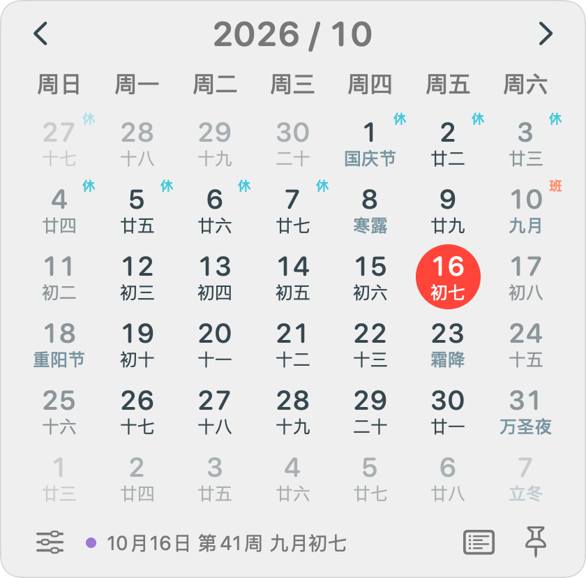
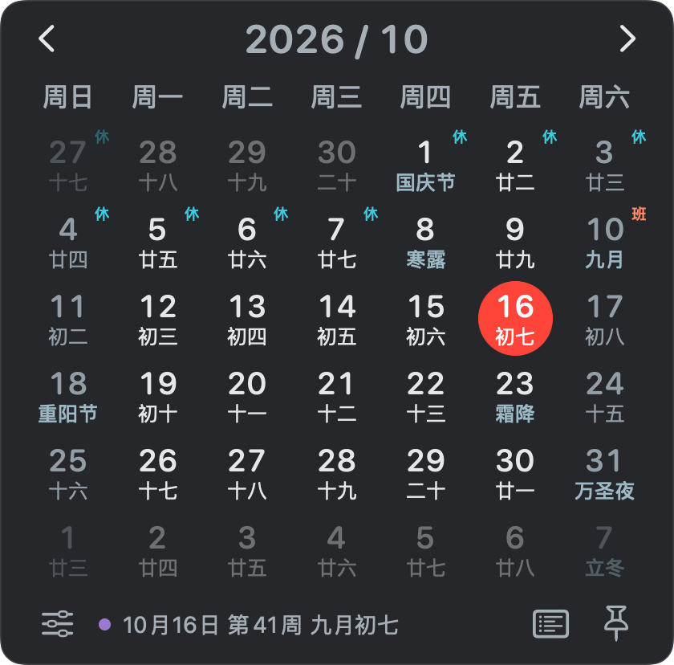
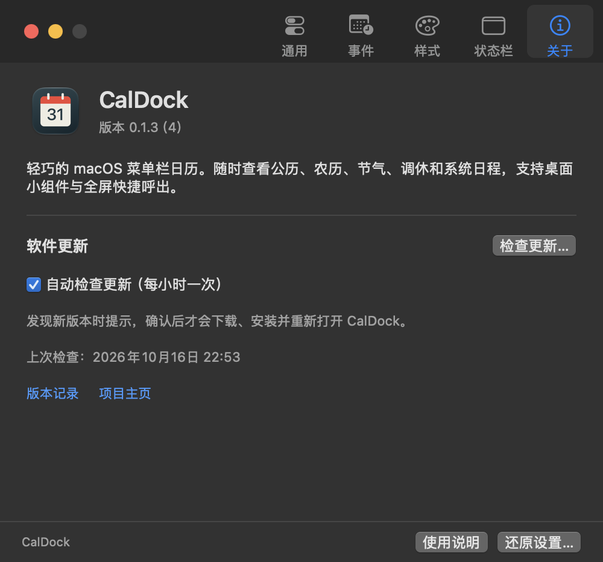

<p align="center"></p>
<h1 align="center">CalDock</h1>
<p align="center">一眼知日期，轻巧在菜单栏。</p>
<p align="center">为 macOS 打造的原生日历，公历、农历、节气与日程，随手可见。</p>

<p align="center">
  <a href="https://github.com/yuhuotech/CalDock/releases/latest"></a>
  
  
  <a href="LICENSE"></a>
  <a href="https://github.com/yuhuotech/CalDock/actions/workflows/macos.yml"></a>
</p>

<p align="center">
  <a href="https://caldock.yuhuotech.com">官网</a> ·
  <a href="https://github.com/yuhuotech/CalDock/releases/latest">下载安装</a> ·
  <a href="https://github.com/yuhuotech/CalDock/issues">反馈问题</a> ·
  <a href="docs/DEVELOPMENT.md">开发指南</a>
</p>

## 简介

CalDock 是一款免费、开源的 macOS 菜单栏日历。点击日期即可展开紧凑月历，也可以在全屏工作时通过快捷键呼出。它使用 Swift、AppKit 和 SwiftUI 构建，保持原生体验，关注空闲时的资源占用。

## 界面预览

<p align="center">
  
  &nbsp;&nbsp;
  
</p>

<details>
  <summary>查看“关于与软件更新”页面</summary>
  <p></p>
</details>

月历图片由实际 SwiftUI 视图导出；设置页为实际运行截图，不包含私人日程。

## 特色

- **原生、紧凑**：默认宽 280 pt 的六周月历，字号、行高和面板宽度可调整。
- **中文日历**：公历、农历、传统节日、二十四节气及已收录年份的官方休假/补班标记。
- **系统日程**：授权后查看事件圆点、当天议程，筛选日历并创建事件。
- **快速日程**：展开日程后点击 `＋`，用小型面板添加系统事件或提醒；每行右侧可直接编辑或确认删除，并同步回 macOS。
- **菜单栏适配**：日期图标随明暗外观调整，也可固定颜色；日期、星期、时间等模块可开关、排序。
- **全屏快捷呼出**：默认 `⌃⌘X`，支持自定义快捷键、悬停打开、固定面板及键盘导航。
- **桌面小组件**：WidgetKit 小、中、大三种尺寸，共享显示设置，支持独立配色。
- **更新与提醒**：可选节日前提醒、开机启动；支持手动更新和每小时自动检查，安装前需确认。
- **本地与轻量**：日程仅在本机处理，无统计 SDK；收起面板后释放日历视图，不轮询日程。

## 下载与安装

要求 **macOS 14 或以上**，同一 Universal 安装包支持 Apple Silicon 与 Intel。

1. 前往 [最新 Release](https://github.com/yuhuotech/CalDock/releases/latest)，下载 `CalDock-universal-X.Y.Z.dmg`。
2. 打开 DMG，将 CalDock 拖入“应用程序”文件夹。
3. 从“应用程序”启动 CalDock，点击菜单栏日期打开月历。

也可下载 ZIP，解压后将应用移入“应用程序”。Release 同时提供 SHA256 校验文件。正式安装包经过 Developer ID 签名和 Apple 公证；macOS 正常的首次打开确认、日历或通知授权仍会保留。

建议只保留一个正在运行的副本，避免从下载目录、DMG 和“应用程序”同时启动而出现重复图标。

## 使用

| 操作 | 快捷方式 |
| --- | --- |
| 打开或收起月历 | 点击菜单栏图标，或 `⌃⌘X` |
| 切换月份 | `←` / `→`，或点击月份箭头 |
| 移动选中日期 | `↑` / `↓` 移动一周 |
| 回到今天 | 空格 |
| 展开 / 收起议程 | `A` |
| 固定 / 取消固定面板 | `P` |
| 打开设置 | `⌘,` |
| 收起面板 | `Esc` |

点击月份标题可跳转年月；按住 Option 点击月份箭头可切换年份；右键日期可复制或打开系统日历。右键菜单栏图标可进入设置、关于或退出。

添加小组件：在桌面或通知中心选择“编辑小组件”，搜索 **CalDock**。

### 软件更新

在“设置 → 关于”查看当前版本和手动检查更新。启用“自动检查更新”后每小时检查一次，发现新版本会提示，由你确认后再下载、安装并重新打开。0.1.2 及更早版本需先手动安装包含更新功能的版本。

## 隐私与资源占用

日历和通知由你主动授权。日程不会上传；系统日历的同步由 macOS 自身管理。软件更新检查访问 GitHub 的签名更新源，关闭自动检查后只在手动点击时请求。节假日更新独立访问 Gitee、提莫或程序世界，只请求年份，不发送日程。可在“设置 → 事件”关闭自动更新。CalDock 不包含广告、统计 SDK 或额外常驻后台服务。

面板默认在点击其他应用时收起；单纯移动鼠标经过面板边缘不会触发关闭。编辑、授权和删除确认期间不会自动收起，按 `Esc` 可主动关闭。

默认按分钟更新菜单栏；在状态栏设置中开启“显示秒”会自动启用时间模块并启用秒级更新。日程通过 EventKit 变更通知按可见范围读取；收起月历后停止视图刷新。具体资源占用与系统、日历数量和设置有关，验证方法见 [开发指南](docs/DEVELOPMENT.md)。

## 从源码构建

需要 macOS 和 Xcode。签名、App Group、系统权限与公证要求见 [开发与发布](docs/DEVELOPMENT.md)。

```sh
git clone https://github.com/yuhuotech/CalDock.git
cd CalDock
swift test
CALDOCK_SIGN_IDENTITY=- bash scripts/build-app.sh debug
open build/CalDock.app
```

临时签名仅适合隔离开发，不保证系统日历授权、共享容器及更新功能可用。正式分发请使用 Developer ID 签名与 Apple 公证。

## 常见问题

**全屏时为什么看不到菜单栏图标？**

如果 macOS 隐藏整个菜单栏，图标也会暂时隐藏。使用 `⌃⌘X` 可在全屏空间中呼出月历。刘海屏图标被挤出时，可以按住 `⌘` 拖动图标或减少状态栏显示模块。

**没有授权日历，还能用吗？**

可以。月历、农历、节气和调休展示不依赖日历授权；只有系统日程功能需要访问权限。

**调休数据覆盖哪些年份？**

内置 2026 年官方放假调休安排，并每日自动检查当年、下一年的新数据，不必等待应用升级。默认本机时间 10:00 检查；首次启动或漏检后在 08:00–22:00 补查，睡眠时不唤醒电脑。失败后间隔 30 分钟重试，自动检查每天最多 3 次；当年数据成功后当天不再自动检查，手动检查不受时间窗口限制。

“设置 → 事件”可开关自动更新、立即检查，查看已收录年份、数据来源和最近检查／成功时间。按 Gitee → 提莫 → 程序世界顺序切换，节假日更新不依赖 GitHub。下载数据经过年份、日期、完整性校验后原子保存到本地，菜单栏、小组件和节日提醒共用更新后的安排；断网、空数据或未公布年份不会覆盖已有数据。最终以国务院公告为准。详细数据源与调度机制见 [节假日自动更新](docs/HOLIDAYS.md)。

日历展示支持 1901–2099 年；未收录年份不会猜测补班；节气显示日期，不提供精确交节时刻。

## 参与贡献

欢迎 [报告问题](https://github.com/yuhuotech/CalDock/issues)、提出建议或提交 Pull Request。开始前请阅读 [贡献指南](CONTRIBUTING.md)。

## 致谢与数据来源

- [Sparkle](https://sparkle-project.org)：应用内更新；保留其原始许可证及第三方声明。
- [国务院办公厅关于2026年部分节假日安排的通知](https://www.beijing.gov.cn/zhengce/zhengcefagui/202511/t20251104_4258873.html)：内置休假与补班数据来源。
- [holiday-calendar（Gitee）](https://gitee.com/cg-zhou/holiday-calendar)、[提莫节假日 API](https://timor.tech/api/holiday)、[程序世界](https://appworlds.cn/holiday/)：在线节假日与补班数据；保留 [holiday-calendar 的 MIT 声明](Sources/CalendarCore/Resources/HolidayData-LICENSE.txt)。
- Apple 的 AppKit、SwiftUI、EventKit 与 WidgetKit。

## 许可证

CalDock 采用 [MIT License](LICENSE)。允许使用、修改、分发和商业使用，需保留版权与许可声明。第三方组件遵循各自许可证。
